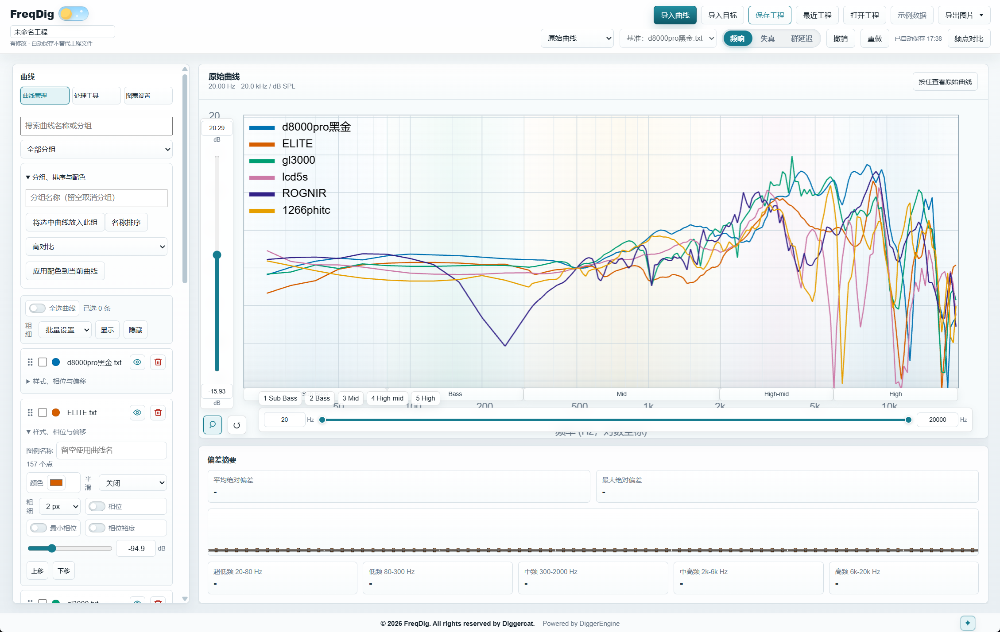
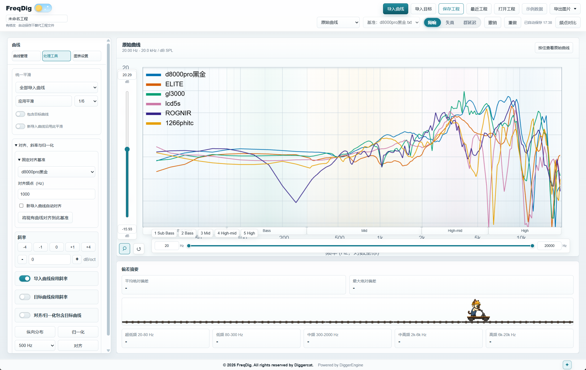
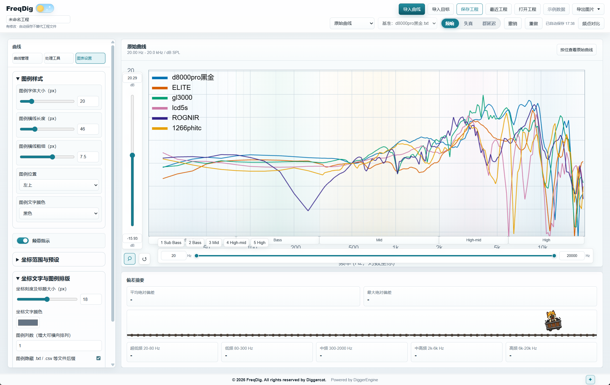
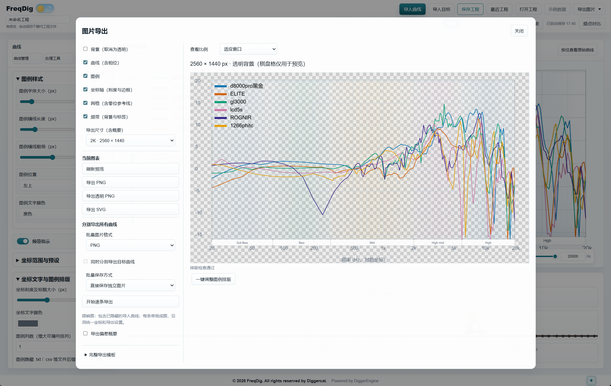

# FreqDig-ff

基于 FreqDig 的开源修改版，用于耳机频响、失真与群延迟曲线的导入、比较和图片导出。当前版本：**0.0.6**。

原始软件及其版权归 Diggercat（挖煤猫）所有。本仓库保留原作者署名和 MIT 许可证，提供界面、曲线管理、工程恢复和图片导出方面的改进。
## 软件截图









## 主要功能

- 导入 CSV/TXT/FRD/DAT 频响文本，支持可选相位列；提供原始、参考差异与目标差异视图。
- REW THD 文本失真分析，以及从相位计算的群延迟分析。
- 曲线平滑、斜率、偏移、对齐与归一化；统一平滑范围、固定对齐基准、按住查看原始曲线。
- 曲线分组、搜索、排序、独显、重复导入处理，以及高对比、色觉友好和打印配色。
- 图例字体、示意线、文字颜色、自定义名称、拖动位置和多列排版。
- 手动坐标、命名预设、滑块与数值输入；显隐曲线时保持统一自动坐标范围。
- PNG、透明 PNG、SVG 导出，背景、曲线、图例、坐标轴、网格和频带独立选择。
- 1080p、2K（2560×1440）、4K 和自定义尺寸；命名尺寸预设、完整导出模板、实时预览与排版检查。
- 每条曲线分别导出为 ZIP，或直接保存独立图片；桌面版选择一次目录即可。
- 工程 JSON 保存/打开、撤销/重做、自动保存、启动恢复和最近工程。
- 可自定义频点的对比表及 CSV 导出。

## Windows 安装版

在本仓库的 [Releases](https://github.com/gpf1202/FreqDig-ff/releases) 页面查找 Windows 安装包。若尚无发布版本，请使用以下源码运行方法。

## 从源码运行

先安装 Node.js（建议 LTS），然后在项目根目录执行：

```bash
npm ci
npm run desktop
```

也可以作为本地网页运行：

```bash
npm start
```

浏览器访问 http://127.0.0.1:8000/index.html 。网页版直接批量保存使用多文件下载，可能需要允许浏览器的多文件下载权限。

## 构建 Windows 安装包

在 Windows 上运行：

```bash
npm ci
npm run build:win
```

生成的安装包位于 dist/。首次构建需联网下载 Electron 及构建工具。

## 验证

```bash
npm run test:chart-settings
npm run test:workflow
npm run test:workspace
npm run test:curve-management
node scripts/test-image-export.cjs
npm run test:desktop
```

桌面测试使用隔离窗口与临时应用数据，覆盖导入、曲线管理、工程恢复、导出尺寸、透明度、内容组合及直接图片保存。

## 使用说明

- [第一版至 0.0.6 更新说明](第一版至0.0.6更新说明.md)
- [当前版本使用说明](使用说明.md)


最近工程、自动恢复与模板存储在本机应用数据中。需要备份或跨电脑使用时，请另存工程 JSON。批量逐条导出和频点对比主要适用于频响模式。REW .mdat 二进制文件不直接解析，请先导出为文本。

## License

MIT。请保留 [LICENSE](LICENSE) 中的原作者版权及许可声明。

